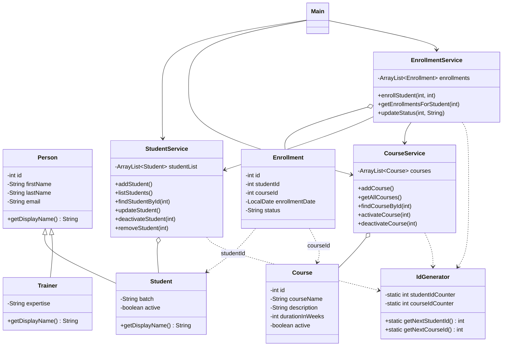

# LearnTrack - Student & Course Management System

LearnTrack is a console based (menu driven) application made using Core Java. An admin can manage students, courses and enrollments. All the data is stored in memory using ArrayList, so data will be lost when the program is closed.

This project was made to practice Java basics, OOP concepts, collections and exception handling.

## Features

**Student Management**
- Add new student (with or without email)
- View all students
- Search student by ID
- Update student email / batch
- Deactivate a student

**Course Management**
- Add new course
- View all courses
- Activate / Deactivate a course

**Enrollment Management**
- Enroll a student in a course
- View enrollments of a student
- Mark enrollment as COMPLETED or CANCELLED
- View all enrollments

Some sample students and courses are added automatically when the program starts, so it's easy to test.

## Project Structure

```
LearnTrack
├── README.md
├── docs
│   ├── Setup_Instructions.md
│   ├── JVM_Basics.md
│   └── Design_Notes.md
└── src/com/airtribe/learntrack
    ├── entity
    │   ├── Person.java
    │   ├── Student.java
    │   ├── Trainer.java
    │   ├── Course.java
    │   └── Enrollment.java
    ├── service
    │   ├── StudentService.java
    │   ├── CourseService.java
    │   └── EnrollmentService.java
    ├── exception
    │   ├── EntityNotFoundException.java
    │   └── InvalidInputException.java
    ├── util
    │   ├── IdGenerator.java
    │   └── InputValidator.java
    └── ui
        └── Main.java
```

## How to compile and run

You need JDK installed (I used JDK 21, but 11+ should work).

From the project root folder (`LearnTrack`):

```
javac -d out $(find src -name "*.java")
java -cp out com.airtribe.learntrack.ui.Main
```

On Windows (command prompt):

```
dir /s /b src\*.java > sources.txt
javac -d out @sources.txt
java -cp out com.airtribe.learntrack.ui.Main
```

Or open the project in IntelliJ / VS Code, mark `src` as source folder and run `Main.java`.

## Class Diagram



## Concepts used

- Packages, classes, objects, constructors (and constructor overloading in `Student`)
- Encapsulation - private fields with getters and setters
- Inheritance - `Student` and `Trainer` extend `Person`
- Polymorphism - `getDisplayName()` is overridden
- Static members - `IdGenerator`, `InputValidator`, status constants
- Method overloading - `addStudent()` with and without email
- ArrayList for storing data
- Custom exceptions + try/catch for invalid input

More details are in [docs/Design_Notes.md](docs/Design_Notes.md).
